# 🎯 Personal Portfolio Website

> **Live Website (Cloudflare Pages):** [https://aaradhya-malaviya-portfolio.pages.dev/](https://aaradhya-malaviya-portfolio.pages.dev/)  
> **Live Mirror (Vercel):** [https://aaradhya-malaviya-portfolio.vercel.app/](https://aaradhya-malaviya-portfolio.vercel.app/)  
> **GitHub Repository:** [https://github.com/AradhyaMalaviya/Portfolio](https://github.com/AradhyaMalaviya/Portfolio) (Redirected from `my-portfolio`)  
> **Release Version:** `v2.1.0` (Production Cloudflare Pages Edge Deployment & Vercel Mirror)

---

# 💼 Personal Portfolio Website by Aaradhya Malaviya

Welcome to my **Personal Portfolio Website**, a premium, highly interactive Single-Page Application (SPA) designed to showcase my skills, projects, certifications, and career objectives. It acts as a comprehensive digital resume with a modern, glassmorphism-based aesthetic.

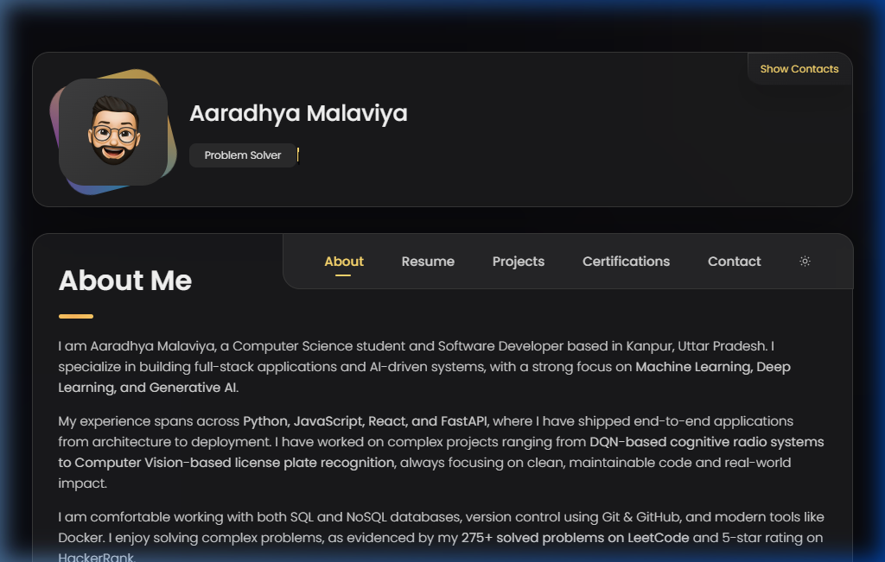

---

## 🌟 Overview

**Website Sections:**
- **About Me** – Introduction, career aspirations, and professional background.
- **Resume** – Education, experience timeline, technical skills, and achievements.
- **Projects** – Dynamic GitHub-powered project showcase with **live preview images**, 3D tilt effects, and language filtering.
- **Certifications** – Interactive certificate gallery with modal previews (PDF/Image support).
- **Contact** – Contact form (FormSubmit AJAX integration with real-time feedback).

---

## 🚀 Projects — Live Preview Cards

Each project card displays a **real screenshot** of the deployed application, replacing generic folder icons with rich visual previews. Clicking any preview opens the live deployment or the GitHub source.

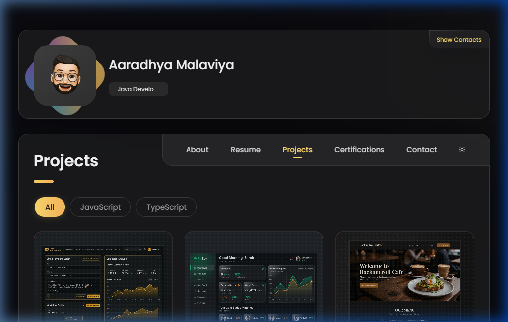

### Project Cards in Detail

Every card includes the project preview image, technology tags, star/fork counts, action buttons (Source + Live Demo), and hover effects with a glassmorphism "View Live" overlay.

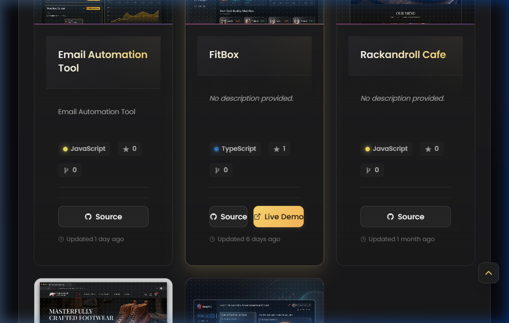

### Showcased Flagship Projects

| Project | Visibility | Preview | Tech Stack | Live Demo / Repo |
|---------|------------|---------|------------|------------------|
| **FitBox** | Public | AI Fitness & Nutrition Ecosystem | TypeScript, React, FastAPI, PostgreSQL | [Live App](https://fitbox-cto.pages.dev/auth) · [GitHub](https://github.com/AradhyaMalaviya/FitBox) |
| **Neural Retail AI** | Public | Sales Intelligence & Demand Forecasting | Python, Scikit-learn, FastAPI, XGBoost | [GitHub Source](https://github.com/AradhyaMalaviya/Neural-Retail-AI) |
| **GenAI Cognitive Radio** | Public | 5G & Satellite Link Optimizer (DQN) | Python, PyTorch, Reinforcement Learning | [GitHub Source](https://github.com/AradhyaMalaviya/genai-cognitive-radio) |
| **MediCare AI** | Public | Clinical Triage & Medicine Recommender | Python, Scikit-Learn, Flask, Docker | [GitHub Source](https://github.com/AradhyaMalaviya/MED-AI) |
| **Heart Disease Predictions** | Public | Clinical Cardiac Risk Assessment | Python, Scikit-learn, FastAPI, Vercel | [Live App](https://heartdisease-taupe.vercel.app) · [GitHub](https://github.com/AradhyaMalaviya/HEART_DISEASES-_PREDICTIONS-) |
| **Heart Risk AI** | Private | High-Precision Cardiac Predictor API | Python, FastAPI, TypeScript, Scikit-learn | [Live App](https://heart-risk-ai.vercel.app) · [Private Repo](https://github.com/AradhyaMalaviya/heart-risk-ai) |
| **DetoxWithBagga** | Public | Emotional Wellness & Therapy Portal | TypeScript, Next.js 16, Framer Motion | [Live App](https://detoxingwithbagga.vercel.app) · [GitHub](https://github.com/AradhyaMalaviya/Detoxing) |
| **NorthPeak Digital** | Public | Enterprise Web Platform (100/100 Lighthouse) | HTML5, CSS3, JavaScript, Vercel | [Live App](https://web-development-internship-project.vercel.app) · [GitHub](https://github.com/AradhyaMalaviya/Web-Development-Internship-Project) |
| **License Plate Recognition** | Public | Real-time Computer Vision ALPR | Python, OpenCV, EasyOCR, NumPy | [GitHub Source](https://github.com/AradhyaMalaviya/license-plate-recognition) |
| **Email Automation Tool** | Public | Recruiter Batch Outreach Engine | JavaScript, Node.js, Nodemailer | [GitHub Source](https://github.com/AradhyaMalaviya/email-automation-tool) |
| **Internship Finder Tool** | Private | Automated Lead Scraping & Dispatch | JavaScript, Node.js, Express, Cheerio | [Private Repo](https://github.com/AradhyaMalaviya/Internship-finder-automation-tool) |
| **Accredian Enterprise Clone** | Public | Enterprise Marketing Platform Clone | TypeScript, Next.js, Tailwind, Framer Motion | [Live App](https://accredian-enterprise-clone-gray.vercel.app) · [GitHub](https://github.com/AradhyaMalaviya/accredian-enterprise-clone) |
| **Bulk Email Sender (SvelteKit)** | Public | Enterprise Bulk Campaign Sender | Svelte, SvelteKit, TypeScript, Tailwind | [Live App](https://assigment1-pi-pearl.vercel.app) · [GitHub](https://github.com/AradhyaMalaviya/assigment1) |
| **Rackandroll Cafe** | Public | Gaming Lounge & Cafe Booking Platform | JavaScript, Node.js, Express, MongoDB | [GitHub Source](https://github.com/AradhyaMalaviya/rackandroll-cafe) |
| **TheBadgerCompany** | Public | Luxury Footwear E-Commerce Store | JavaScript, React, Vite, Tailwind | [GitHub Source](https://github.com/AradhyaMalaviya/thebadgercompany) |

> **Complete 35-Project Registry:** Every single project made so far — spanning **18 Public repositories** and **17 Private repositories** — is indexed on the live portfolio with category tabs, live keywords search, and real-time GitHub synchronization.

### FitBox — AI Fitness Coach (Live Deployment)

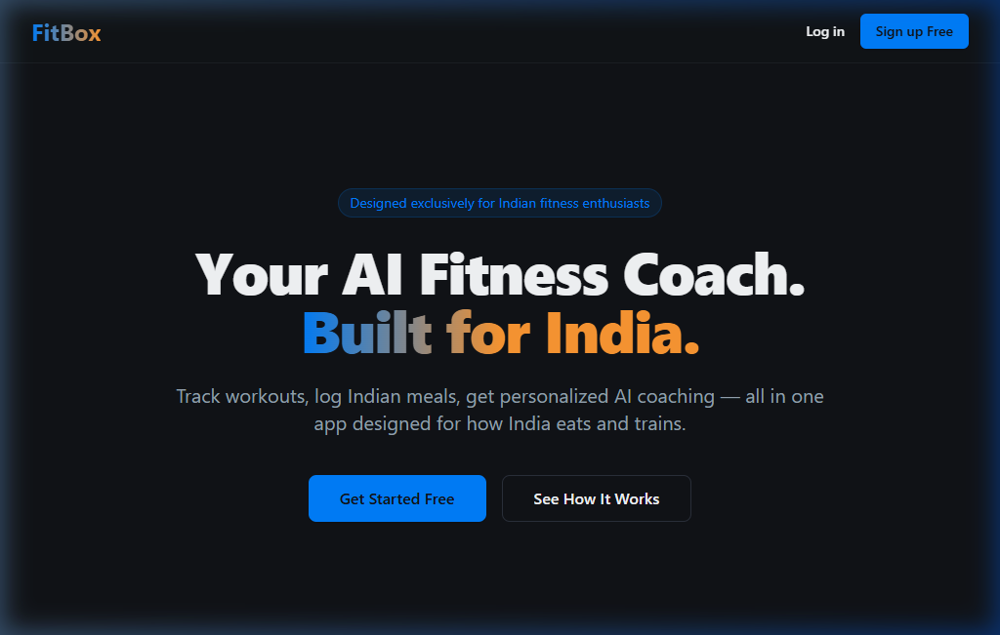

---

## 🎯 Career Objective

Actively seeking **Software Developer**, **Full-Stack Developer**, and **AI/ML Engineer** roles. Experienced in:
- Full-stack web development (React, Node.js, Express, FastAPI)
- AI/ML systems (PyTorch, Scikit-learn, OpenCV, EasyOCR, DQN)
- Generative AI (LLMs, Prompt Engineering, AI Agents, Anthropic, AWS)
- Database management (SQL, NoSQL)
- Cloud & DevOps (AWS, Docker, Git, GitHub)
- Deployment (Cloudflare Pages, Docker, Vercel, Netlify)

---

## 🔧 Technology Stack

### Portfolio Website Stack
| Category | Technologies |
|----------|-------------|
| **Structure** | HTML5 (Semantic SPA layout) |
| **Styling** | Vanilla CSS3 (Custom variables, glassmorphism, responsive design) |
| **Logic** | Vanilla JavaScript ES6 (GitHub API, 3D tilt, typing, scroll reveal) |
| **Icons** | Ionicons (CDN) |
| **Contact** | FormSubmit (AJAX with loading/success/error states) |
| **Deployment** | Cloudflare Pages (Primary Production), GitHub Pages (CNAME), Vercel (CI/CD) |

### Professional Stack (Showcased Projects)
| Category | Technologies |
|----------|-------------|
| **Languages** | C++, JavaScript, Python, SQL, HTML, CSS |
| **Frameworks** | React.js, Node.js, Express.js, FastAPI |
| **AI/ML** | pandas, NumPy, scikit-learn, PyTorch, OpenCV, EasyOCR |
| **Cloud & Tools** | AWS, Docker, Git, GitHub, VS Code |
| **Domains** | Machine Learning, Deep Learning, Generative AI, LLMs, NLP |

---

## 📄 Resume Section

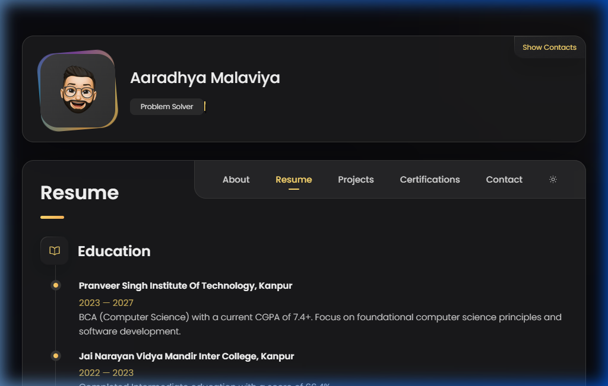

---

## 📈 Key Features

- **Live Project Previews** — Each project card displays a real preview image/screenshot of the application.
- **Clickable Preview Banners** — Banners navigate directly to live deployments or GitHub source.
- **Interactive Hover Effects** — Glassmorphism "View Live" overlay chip and smooth zoom transitions.
- **3D Tilt Effect** — Perspective-based tilt on project cards with glare overlay.
- **Dynamic GitHub Integration** — Real-time project fetching with language filtering and skeleton loading.
- **Premium UI Animations** — Floating background orbs, animated avatar gradient ring, and skill bar progress.
- **Typing Animation** — Animated role rotation in the sidebar.
- **Light/Dark Mode** — Theme toggle with local storage persistence.
- **Contact Form** — FormSubmit AJAX integration with real-time feedback.
- **Interactive Certifications** — Modal previews with PDF/image viewer and keyboard support.
- **Scroll Reveal** — IntersectionObserver-powered fade-in animations.
- **Fully Responsive** — Optimized for all desktop, tablet, and mobile viewports.

---

## 🏆 Certifications

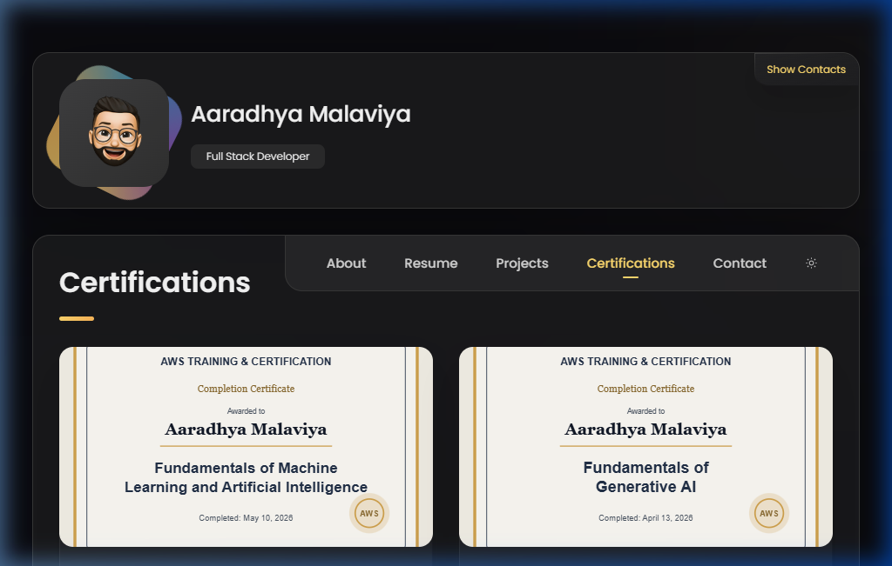

All certificates are viewable in the **Certifications** section with interactive modal previews. Recent certificates include:

**AWS Training & Certification (2026):**
- Fundamentals of Machine Learning and Artificial Intelligence
- Fundamentals of Generative AI
- Foundations of Prompt Engineering
- Introduction to Generative AI: Art of the Possible

**Anthropic Education (2026):**
- Introduction to Model Context Protocol (MCP)
- Claude Platform 101
- AI Fluency: Framework & Foundations
- Claude Code in Action
- Introduction to Claude Cowork
- Claude Code 101
- Claude 101
- Introduction to Agent Skills
- Introduction to Subagents

**Tata Group & Forage:**
- GenAI Powered Data Analytics Job Simulation

**Data Science:**
- Python for Data Science (Infosys / OnWingspan)
- Data Science, ML, DL, NLP Bootcamp (Udemy)

---

## 📱 Mobile View

Fully responsive design across all viewports.

<p align="center">
  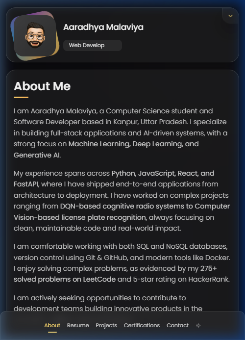
  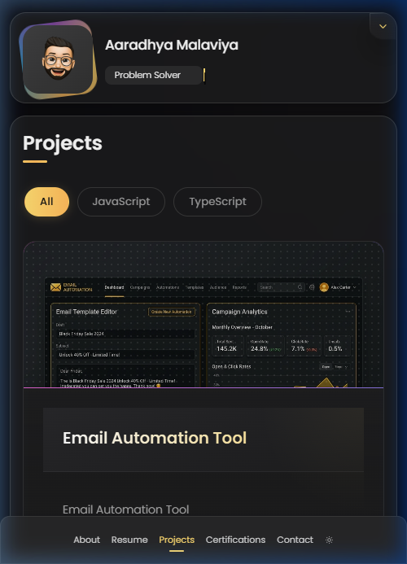
  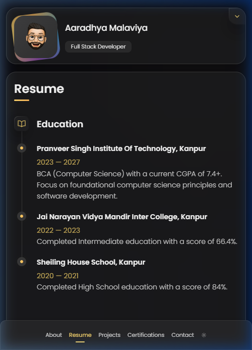
  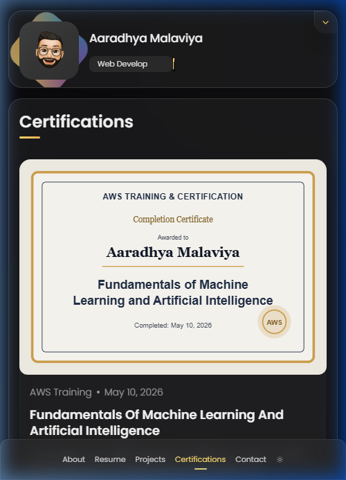
</p>

---

## 📬 Contact

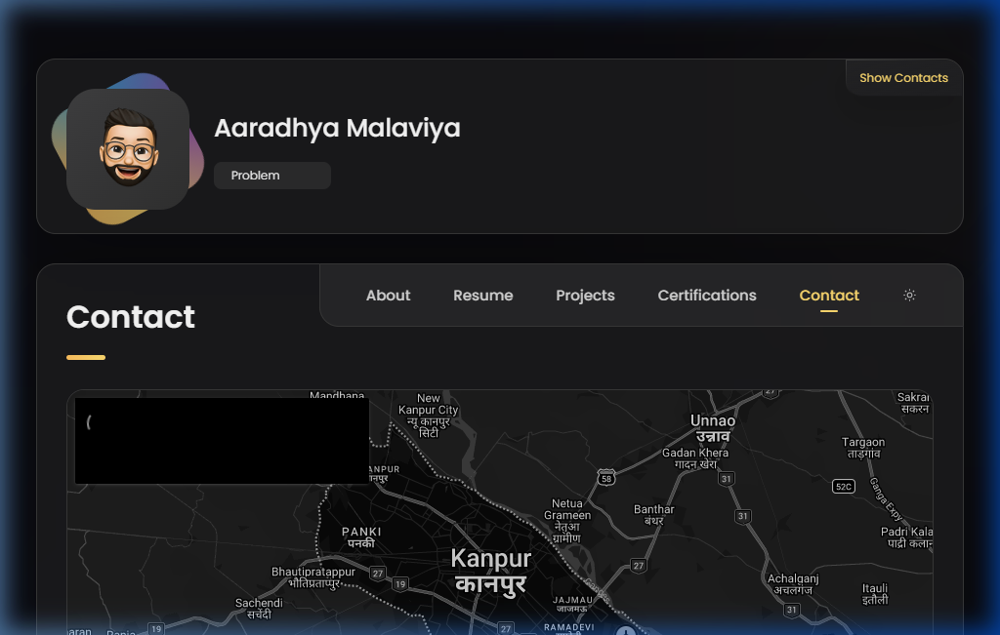

---

## 🚀 Deployment & Cloudflare Pages Hosting

The portfolio is deployed to production using **Cloudflare Pages**, delivering sub-second response times worldwide through Cloudflare's global edge network.

| Environment | Hosting Provider | Deployment URL | Trigger |
|-------------|------------------|----------------|---------|
| **Production (Primary)** | Cloudflare Pages | [https://aaradhya-malaviya-portfolio.pages.dev/](https://aaradhya-malaviya-portfolio.pages.dev/) | Git push to `master` branch |
| **Edge / Staging (Mirror)** | Vercel | [https://aaradhya-malaviya-portfolio.vercel.app/](https://aaradhya-malaviya-portfolio.vercel.app/) | Git push to `master` branch |
| **Local Dev** | Python HTTP Server / Node | `http://localhost:3000` | `npm start` |

### Cloudflare Pages Architecture
- **Continuous Deployment (CI/CD):** Every commit pushed to the `master` branch automatically triggers an immediate, zero-downtime build and deployment on Cloudflare Pages.
- **Edge Security Headers:** Configured via [`_headers`](./_headers) to provide robust security out-of-the-box:
  - `X-Content-Type-Options: nosniff`
  - `X-Frame-Options: SAMEORIGIN`
  - `Referrer-Policy: strict-origin-when-cross-origin`
  - `Permissions-Policy: camera=(), microphone=(), geolocation=()`
- **Asset Optimization & Caching:** All static assets under `/assets/*` are cached with 1-year immutable caching headers (`Cache-Control: public, max-age=31536000, immutable`).
- **Domain Routing:** Canonical URLs, OpenGraph metadata, and Twitter cards are synchronized to `https://aaradhya-malaviya-portfolio.pages.dev/`.

---

## 📁 Project Structure

```
Portfolio/
├── index.html                          # Main SPA entry point
├── 404.html                            # Custom error page
├── GEMINI.md                           # AI assistant context file
├── PRD.md                              # Master Tech Spec (v4.0)
├── README.md                           # This file
├── indeed-application-queue.md         # Job application tracker
├── assets/
│   ├── css/
│   │   └── style.css                   # Central stylesheet (~3400 lines)
│   ├── js/
│   │   └── script.js                   # Central logic file (~755 lines)
│   ├── images/
│   │   ├── my-avatar.png               # Profile avatar
│   │   ├── certificates/               # SVG previews for certificates
│   │   ├── readme/                     # README screenshots
│   │   └── projects/                   # Project preview images
│   └── certificates/                   # Source PDF/JPG certificates
└── resume file/                        # Downloadable resume documents
```

---

## 🔄 Recent Updates

- **v2.1.0 Cloudflare Pages Production Release:** Updated production deployment architecture, added Anthropic and AWS 2026 key certifications, integrated security headers (`_headers`), updated resume downloads, and resolved technical SEO and accessibility audits.
- **Premium UI Refactor:** Added animated background floating orbs, a conic-gradient rotating ring for the profile avatar, and scroll-triggered skill progress bar animations.
- **Project Preview Cards:** Replaced generic icons with **real screenshots** from live deployments. Clickable banners link to Vercel deployments or GitHub source.
- **GitHub API Branding:** Implemented `hashColor` logic to generate unique, consistent branding gradients for all dynamic repository cards.
- **README Overhaul:** Replaced all placeholder images with real production screenshots captured directly from the live site.
- **Experience Timeline:** Added the latest Jan 2026 — Present "GenAI-Powered Cognitive Radio" project and Oct 2025 "License Plate Recognition" system to the resume timeline.
- **Certifications:** Integrated 2026 AWS and Anthropic certifications with interactive modal previews.

---

## 📝 Future Goals

- Contribute to **open-source projects**.
- Build advanced **AI-powered agents and distributed systems**.
- Participate in more **hackathons** and collaborative projects.

---

Thank you for visiting my portfolio!

Feel free to connect for **collaboration, internships, or job opportunities**.

---

## 📫 Let's Connect

- **Email:** aaradhya.malaviya2005@gmail.com
- **GitHub:** [AradhyaMalaviya](https://github.com/AradhyaMalaviya)
- **LinkedIn:** [aaradhya-malaviya](https://linkedin.com/in/aaradhya-malaviya)
